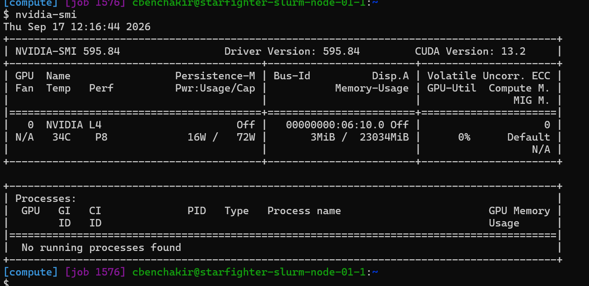
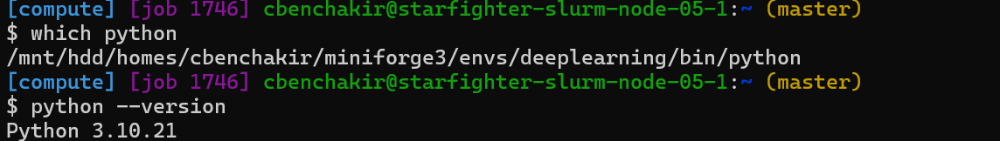
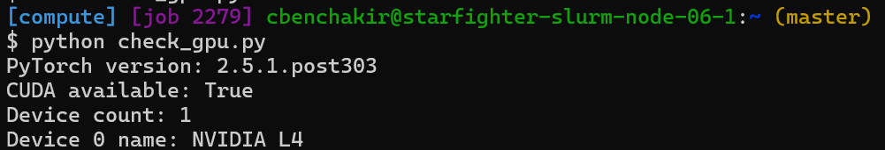
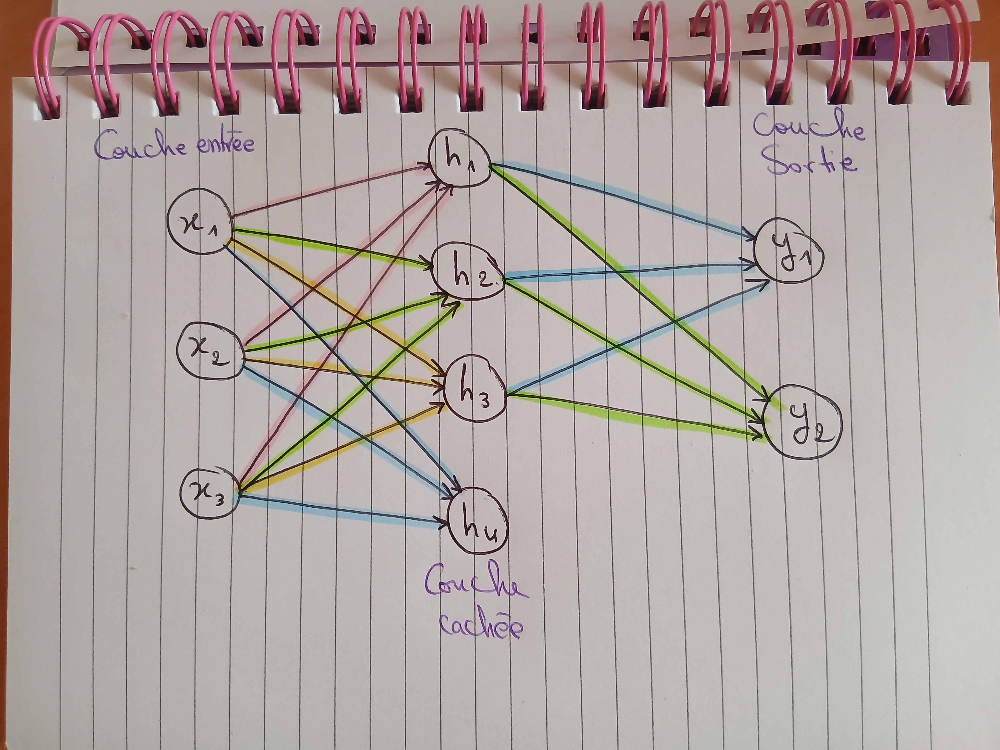
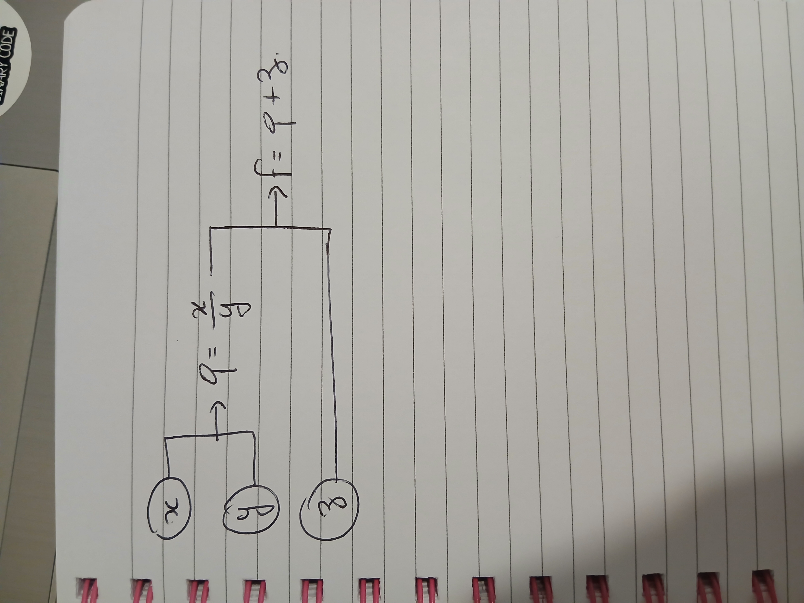
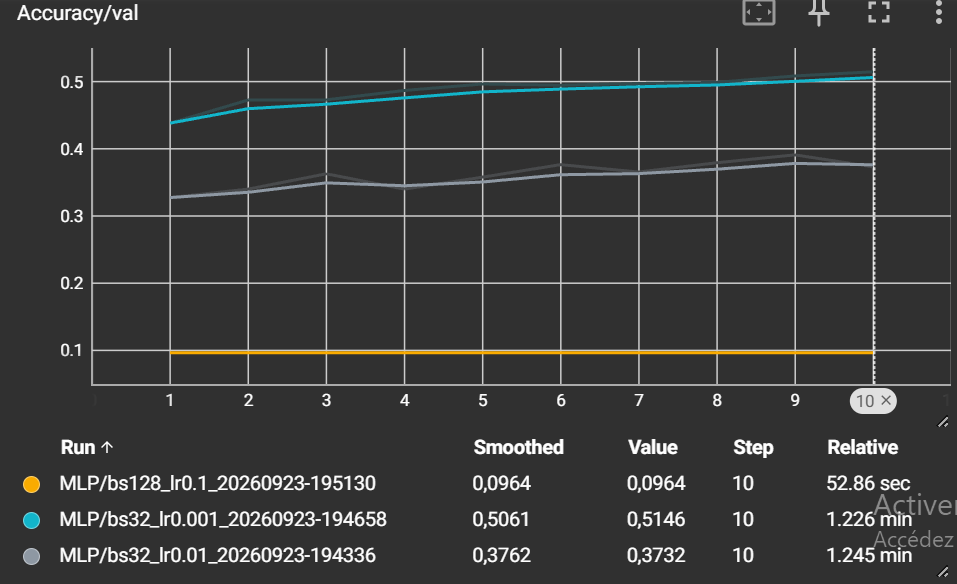
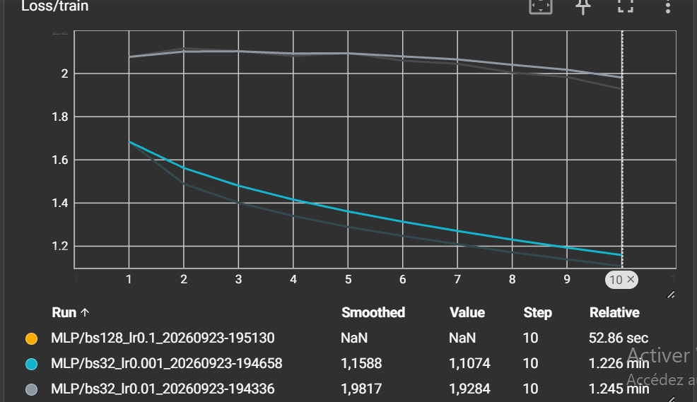
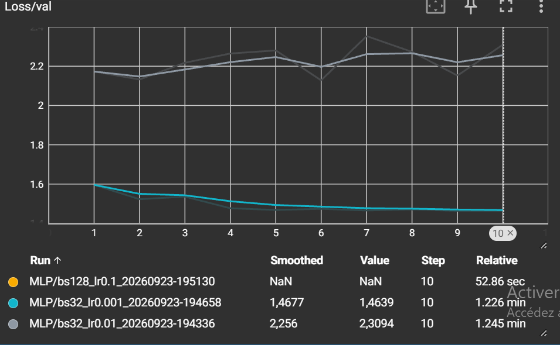

# TP1 — Premiers pas en Deep Learning

**Cheyma Benchakir**

---

# 1. Utilisation de SLURM

## GPU alloué



## Annulation d'un job

Commande utilisée :

```bash
scancel 1576
```

## Fichier de log du job Slurm

Le fichier de log généré est :

```text
hello-slurm-1579.out
```

## Différence entre ReqMem et MaxRSS

**ReqMem** correspond à la quantité de mémoire demandée à Slurm lors de la soumission du job. **MaxRSS** correspond à la quantité maximale de mémoire réellement utilisée par le job pendant son exécution.

---

# 2. Environnement Python et PyTorch

## Version de Python et chemin du binaire

Commandes utilisées :

```bash
python --version
which python
```



## Vérification de PyTorch et CUDA

Sortie de `python check_gpu.py` :



## Version de TensorBoard

Commande utilisée :

```bash
tensorboard --version
```

---

# 3. Exercices théoriques

## Architecture et paramètres du MLP

## Schéma de MLP



Le réseau possède 3 neurones d'entrée, 4 neurones dans la couche cachée et 2 neurones de sortie.

Sans les biais :

$$
3 \times 4 + 4 \times 2 = 12 + 8 = 20
$$

Le modèle possède donc **20 paramètres sans les biais**.

Avec les biais, on ajoute 4 biais pour la couche cachée et 2 biais pour la couche de sortie :

$$
20 + 4 + 2 = 26
$$

Le modèle possède donc **26 paramètres avec les biais**.

## Équations et dimensions

$$
H = \mathrm{ReLU}(XW_1^T+b_1)
$$

$$
Y = HW_2^T+b_2
$$

```text
X  : (N, 3)
W1 : (4, 3)
b1 : (1, 4) -> diffusé en (N, 4)
H  : (N, 4)
W2 : (2, 4)
b2 : (1, 2) -> diffusé en (N, 2)
Y  : (N, 2)
```

## Graphe de calcul et rétropropagation

On considère :

$$
f(x,y,z)=\frac{x}{y}+z
$$

avec :

$$
x=2,\qquad y=4,\qquad z=0
$$

### Graphe de calcul



On introduit le nœud intermédiaire :

$$
q=\frac{x}{y}
$$

puis :

$$
f=q+z
$$

### Forward pass

$$
q=\frac{2}{4}=0.5
$$

puis :

$$
f=0.5+0=0.5
$$

Donc :

$$
\boxed{f=0.5}
$$

### Backpropagation

Comme :

$$
f=q+z
$$

on a :

$$
\frac{\partial f}{\partial q}=1
\qquad\text{et}\qquad
\frac{\partial f}{\partial z}=1
$$

Pour $q=x/y$ :

$$
\frac{\partial q}{\partial x}=\frac{1}{y}
$$

Donc :

$$
\frac{\partial f}{\partial x}
=
\frac{\partial f}{\partial q}
\frac{\partial q}{\partial x}
=
1\times\frac14
=
0.25
$$

Pour $y$ :

$$
\frac{\partial q}{\partial y}=-\frac{x}{y^2}
$$

Donc :

$$
\frac{\partial f}{\partial y}
=
1\times\left(-\frac{2}{4^2}\right)
=
-\frac{2}{16}
=
-0.125
$$

Enfin :

$$
\frac{\partial f}{\partial z}=1
$$

Ainsi :

$$
\boxed{
\frac{\partial f}{\partial x}=0.25,\qquad
\frac{\partial f}{\partial y}=-0.125,\qquad
\frac{\partial f}{\partial z}=1
}
$$

## Mise à jour par descente de gradient

Avec $\eta=1$ :

$$
x'=x-\eta\frac{\partial f}{\partial x}
=2-0.25=1.75
$$

$$
y'=y-\eta\frac{\partial f}{\partial y}
=4-(-0.125)=4.125
$$

$$
z'=z-\eta\frac{\partial f}{\partial z}
=0-1=-1
$$

La nouvelle valeur est :

$$
f'=\frac{1.75}{4.125}-1\approx-0.576
$$

La valeur de la fonction est passée de $0.5$ à environ $-0.576$ : elle a donc diminué.

### Règle de la chaîne

La règle de la chaîne permet de calculer les gradients dans un réseau composé de plusieurs opérations successives. Elle permet de propager le gradient depuis la sortie vers les différentes couches du réseau lors de la rétropropagation.

### Mini-batchs

Les mini-batchs constituent un compromis entre l'utilisation d'un seul exemple et celle de tout le dataset. Ils permettent d'obtenir des gradients plus stables qu'avec un seul exemple tout en limitant l'utilisation de la mémoire et en profitant du calcul parallèle sur GPU.

## Association sortie / fonction de perte

| Tâche                       | Fonction finale (Sortie) | Fonction de perte (Loss)   |
| --------------------------- | ------------------------ | -------------------------- |
| Classification binaire      | Sigmoïde                 | Binary Cross-Entropy (BCE) |
| Classification multi-classe | Softmax                  | Cross-Entropy              |
| Régression pure             | Identité (aucune)        | MSE (Mean Squared Error)   |

---

# 4. Premier réseau de neurones — CIFAR-10

## DataLoader : `batch_size` et `shuffle`

L'argument **`batch_size`** indique le nombre d'exemples traités simultanément par le modèle lors d'une itération. Il contrôle donc le nombre d'exemples utilisés pour calculer le gradient à chaque étape.

L'argument **`shuffle`** indique si les données sont mélangées avant d'être parcourues. Pendant l'entraînement, on utilise **`shuffle=True`** afin de varier l'ordre des exemples. Pour le test, on utilise **`shuffle=False`** afin de conserver une évaluation déterministe et reproductible.

## `torch.flatten(x, 1)`

`torch.flatten(x, 1)` transforme chaque image en un vecteur 1D tout en conservant la dimension du batch. Une image CIFAR-10 de forme `(3, 32, 32)` devient ainsi un vecteur de taille $3\times32\times32=3072$, compatible avec la première couche linéaire.

## Absence de Softmax avant `nn.CrossEntropyLoss`

Il ne faut pas ajouter de `Softmax` à la sortie du réseau car `nn.CrossEntropyLoss` attend directement les **logits**. PyTorch effectue ensuite les opérations nécessaires de manière numériquement stable ; appliquer `Softmax` avant serait donc redondant.

## L'entraînement du modèle


## Différence entre `optimizer.zero_grad()` et `loss.backward()`

`optimizer.zero_grad()` réinitialise les gradients accumulés dans les paramètres du modèle. `loss.backward()` effectue la rétropropagation et calcule les gradients de la loss par rapport aux paramètres du réseau.

## Évaluation avec `torch.no_grad()`

`with torch.no_grad():` désactive le calcul et le stockage des gradients pendant l'évaluation. Cela réduit l'utilisation de la mémoire et les calculs inutiles, puisque les poids du modèle ne sont pas mis à jour pendant cette phase.

## Accuracy d'un classificateur aléatoire

CIFAR-10 contient 10 classes. Un classificateur choisissant une classe uniformément au hasard aurait donc une accuracy moyenne d'environ :

$$
\frac{1}{10}=0.1=10\%
$$

---

# 5. TensorBoard

Inclure la date, l'heure et les hyperparamètres dans `run_name` permet d'identifier précisément chaque expérience et d'éviter d'écraser les résultats d'un run précédent. Cela facilite également la comparaison des différentes configurations dans TensorBoard.

### Lissage des courbes TensorBoard

J'ai choisi un niveau de **Smoothing de 0,54**, car il permet de réduire
les fluctuations tout en conservant la tendance générale des courbes.

`Loss/train_step` est plus bruitée que `Loss/train` car elle correspond
à la perte calculée sur des mini-batches individuels. La composition des
mini-batches varie au cours de l'entraînement, ce qui provoque des
fluctuations d'un batch à l'autre.

À l'inverse, `Loss/train` est calculée sur l'ensemble des mini-batches
d'une époque. Cette moyenne réduit les variations et produit donc une
courbe plus stable.

### Comparaison des expériences TensorBoard





Les trois configurations testées sont :

| Run   | Learning rate | Batch size | Meilleure accuracy de validation |
| ----- | ------------: | ---------: | -------------------------------: |
| Run 1 |        `1e-2` |         32 |                           39,1 % |
| Run 2 |        `1e-3` |         32 |                           51,5 % |
| Run 3 |        `1e-1` |        128 |                            9,6 % |

La meilleure accuracy de validation est obtenue avec le **Run 2**
(`lr = 1e-3`, `batch_size = 32`), avec environ **51,5 %**.

Le Run 3 (`lr = 1e-1`, `batch_size = 128`) diverge : les pertes
d'entraînement et de validation deviennent `NaN` et l'accuracy reste
autour de 9,6 %.

Visuellement, un surapprentissage peut être identifié lorsque la perte
d'entraînement continue de diminuer alors que la perte de validation
cesse de diminuer ou commence à augmenter. Un écart croissant entre
`Loss/train` et `Loss/val` est donc un indicateur de surapprentissage.


