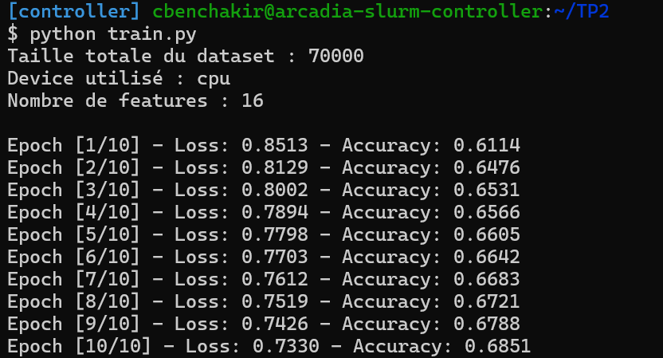
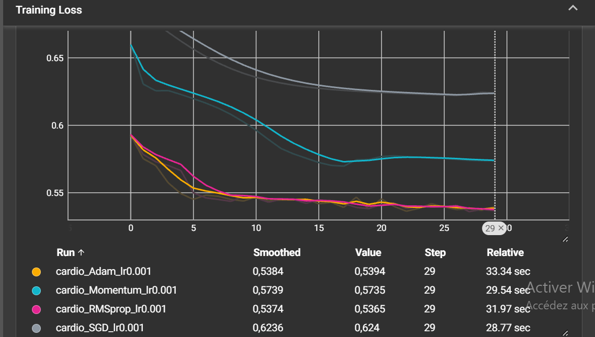
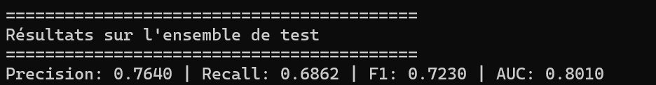

# TP2 — Régularisation, optimisation et métriques

**CSC 8607 — Introduction au Deep Learning**

## 1. Création d'un dataset personnalisé

### StandardScaler

Dans le code, StandardScaler est appliqué avant de séparer les données en train, validation et test. Le problème est que le scaler utilise donc aussi des informations venant des données de test, ce qui crée du data leakage.
Pour éviter cela, il faudrait calculer le scaler uniquement sur les données d’entraînement, puis utiliser le même scaler pour la validation et le test.

### Dataset trop volumineux pour la RAM

Si le dataset est trop volumineux pour tenir en mémoire, par exemple 500 Go, on peut utiliser IterableDataset. Cela permet de charger les données petit à petit pendant l’entraînement au lieu de tout charger en RAM.

## 2. MLP et régularisation L1 / L2

### Effet d'une régularisation L1 forte



Pour voir l'effet d'une régularisation L1 trop forte, j'ai testé la configuration suivante :

- `l1_lambda = 0.1`
- `l2_lambda = 0`

À la dernière époque, j'ai obtenu :

- Loss : `1.6340`
- Accuracy : `49.57 %`

On voit que le modèle n'arrive presque plus à apprendre puisque l'accuracy reste autour de 50 %. La régularisation L1 est trop forte et pousse trop les poids vers zéro. Le modèle devient donc trop limité, ce qui provoque du **sous-apprentissage (underfitting)**.

Avec une régularisation plus faible (`l1_lambda = 1e-4` et `l2_lambda = 1e-3`), j'avais obtenu une loss de `0.7330` et une accuracy de `68.51 %` après 10 époques. La différence montre bien qu'une valeur de L1 trop élevée dégrade l'apprentissage.

### Régularisation L2 avec PyTorch

Pour la régularisation L2, PyTorch permet de l'ajouter directement dans l'optimiseur avec `weight_decay` :

```python
optim.SGD(model.parameters(), lr=0.01, weight_decay=1e-3)
```

Cela permet d'utiliser la régularisation L2 sans devoir ajouter la pénalité manuellement dans la loss.

### Différence entre L1 et L2

La régularisation **L1** pousse certains poids vers zéro. Elle peut donc rendre le modèle plus parcimonieux.

La régularisation **L2** réduit plutôt la valeur des poids sans forcément les mettre à zéro.

==> L1 favorise davantage les poids nuls, alors que L2 cherche surtout à garder des poids faibles.

## 3. Comparaison des optimiseurs et TensorBoard


### Courbes TensorBoard

La figure suivante présente l'évolution de la perte d'entraînement pour
les quatre optimiseurs.




- Adam : `0.5394`
- RMSprop : `0.5365`
- Momentum : `0.5735`
- SGD : `0.6240`

### Optimiseur convergeant le plus rapidement

D'après les courbes TensorBoard, Adam converge très rapidement dès les
premières époques. RMSprop présente lui aussi une convergence rapide et
les deux optimiseurs arrivent finalement à des pertes très proches.

Dans notre expérience, RMSprop obtient une loss finale légèrement plus
faible qu'Adam (`0.5365` contre `0.5394`). Cela ne signifie cependant pas
qu'il converge nécessairement plus rapidement au début : la vitesse de
convergence initiale et la valeur finale de la loss sont deux observations
différentes.

### Comparaison entre SGD et Momentum

La différence entre SGD simple et SGD avec Momentum est clairement visible
sur les courbes. Avec SGD, la loss diminue assez lentement et reste autour
de `0.6240` après 30 époques. Avec Momentum, elle descend jusqu'à environ
`0.5735`.

Le momentum utilise une partie des mises à jour précédentes du gradient.
Cela permet au modèle d'avancer plus rapidement lorsque plusieurs gradients
successifs indiquent une direction similaire, tout en réduisant certaines
oscillations.

Dans notre expérience, l'ajout du momentum accélère donc nettement la
convergence par rapport à SGD simple.
## 4. Analyse des métriques



Les résultats obtenus sont :

- Precision : `0.7640`
- Recall : `0.6862`
- F1-score : `0.7230`
- AUC : `0.8010`

### Précision et rappel

La **précision (Precision)** mesure, parmi les exemples que le modèle a
prédits comme positifs, la proportion qui est réellement positive :

Precision = TP / (TP + FP)

avec `TP` correspond aux vrais positifs et `FP` aux faux positifs.

Le **rappel (Recall)** mesure, parmi tous les exemples réellement positifs,
la proportion qui a été correctement détectée par le modèle :

Recall = TP / (TP + FN)

avec `FN` correspond aux faux négatifs.


### Métrique à privilégier dans le contexte médical

Dans ce contexte, le **rappel** est important car on cherche surtout à éviter les faux négatifs, c'est-à-dire les personnes malades que le modèle ne détecte pas.

Il faut quand même garder une bonne précision pour éviter trop de faux positifs. L'objectif est donc de trouver un bon équilibre entre les deux.

### Intérêt de l'AUC

La précision, le rappel et le F1-score dépendent du seuil choisi, ici `0.5`.

L'AUC permet d'évaluer le modèle sans se limiter à ce seuil. Dans notre cas, on obtient une AUC de `0.8010`, ce qui montre que le modèle arrive plutôt bien à différencier les deux classes.
