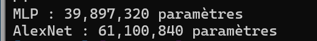
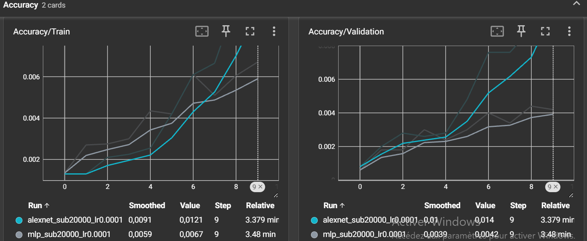
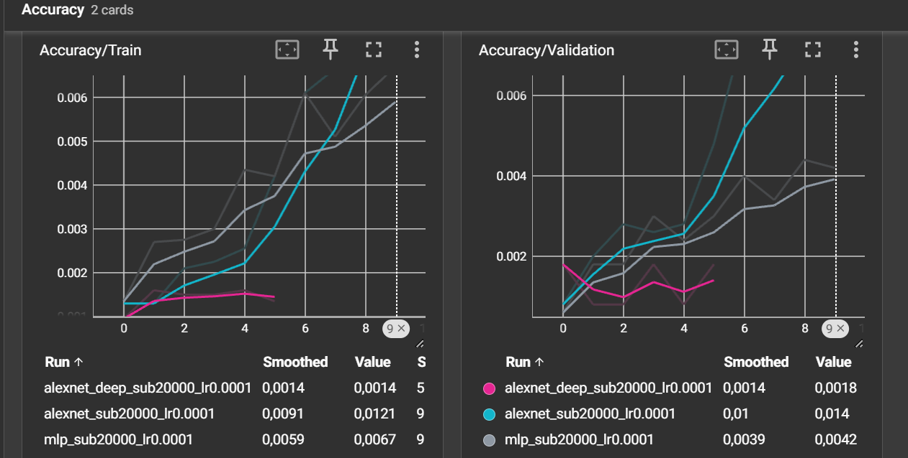
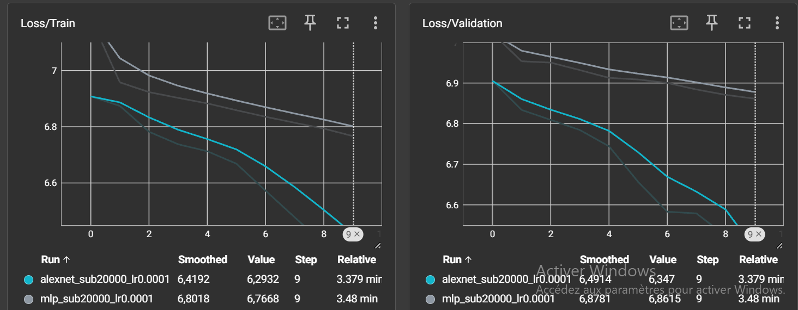
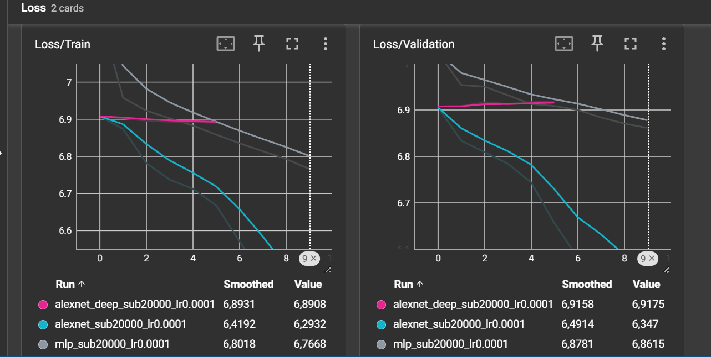
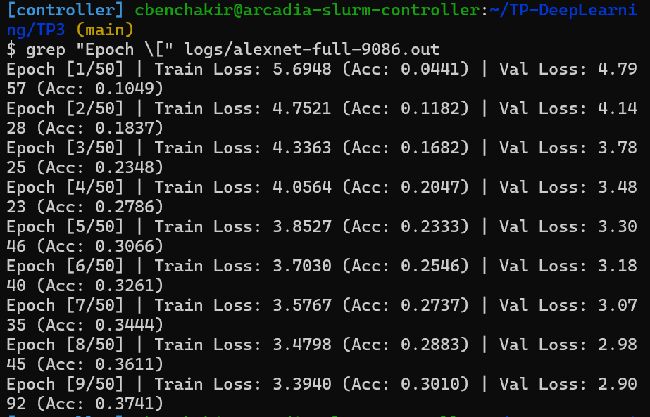
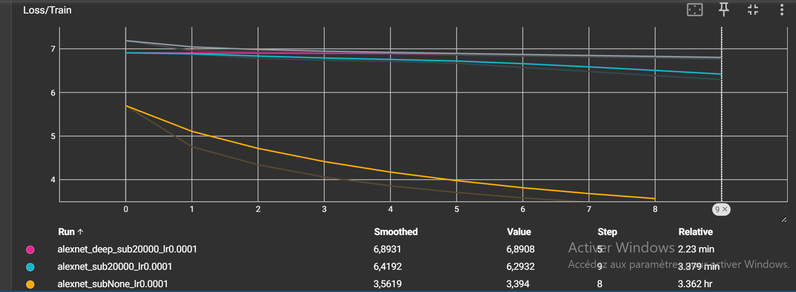
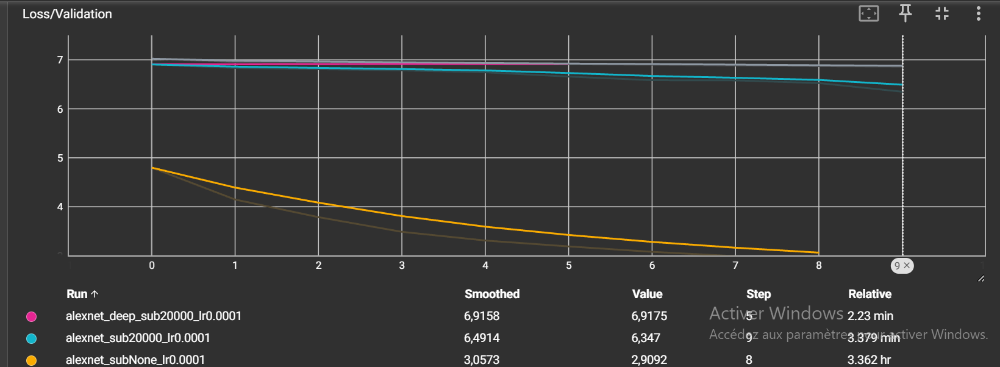
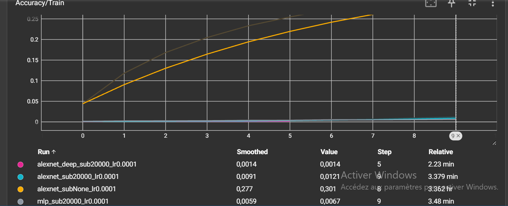
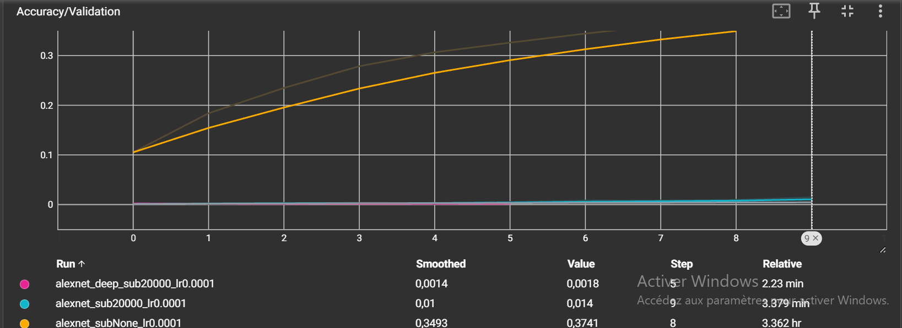

# TP3 — Réseaux convolutifs

  
**BENCHAKIR Cheyma**


## Exercice 1 — Préparation d'ImageNet et augmentation de données

### 1. Effet de l'absence de normalisation et choix des statistiques

Sans transforms.Normalize, les pixels restent entre 0 et 1, mais leurs valeurs ne sont pas centrées autour de zéro. Cela peut modifier l'échelle des gradients et rendre la descente de gradient moins stable ou plus lente. Le réseau peut quand même apprendre, mais l'entraînement risque d'être moins efficace.
Les moyennes et écarts-types doivent être calculés uniquement sur les données d'entraînement pour éviter toute fuite d'information (data leakage). Le jeu de validation doit rester indépendant afin d'évaluer correctement les performances du modèle.

Pendant l'entraînement, on utilise RandomResizedCrop et RandomHorizontalFlip pour créer différentes versions des images. Cela permet au modèle d'apprendre à reconnaître les objets même si leur position ou leur cadrage change, et donc de mieux généraliser.
En validation, on utilise Resize et CenterCrop pour garder les mêmes images à chaque époque. Ainsi, on peut comparer les performances du modèle de manière fiable.

### 3. Exemple où `RandomHorizontalFlip` serait néfaste

Par exemple, pour reconnaître les panneaux de signalisation, RandomHorizontalFlip peut poser problème. Un panneau « tourner à droite » devient « tourner à gauche » après retournement, alors que son étiquette reste inchangée. Le modèle risque donc d'apprendre de mauvaises associations.

---

## Exercice 2 — Étude théorique et implémentation des architectures (MLP vs AlexNet)

### Étape 1 — MLP (baseline)

#### 1. Nombre exact de paramètres avec et sans biais

Le MLP reçoit une image de \(3 \times 227 \times 227 = 154\,587\) valeurs. Pour chaque couche, on multiplie le nombre d'entrées par le nombre de neurones, puis on ajoute les biais.

| Couche | Calcul avec biais | Avec biais | Sans biais |
|---|---|---:|---:|
| Linear1 : 154 587 → 256 | $154\,587\times256+256$ | 39 574 528 | 39 574 272 |
| Linear2 : 256 → 256 | $256\times256+256$ | 65 792 | 65 536 |
| Linear3 : 256 → 1 000 | $256\times1\,000+1\,000$ | 257 000 | 256 000 |
| **Total** | | **39 897 320** | **39 895 808** |

Le nombre total de biais est $256+256+1\,000=1\,512$.

La première couche concentre :

$$
\frac{39\,574\,528}{39\,897\,320}\times100\approx99{,}19\%.
$$

**Linear1 concentre donc plus de 99 % des paramètres** du MLP, car chaque pixel d'entrée est relié à chacun des 256 premiers neurones cachés.

#### 2. Défaut structurel de l'aplatissement (`flatten`)

Le principal défaut du flatten est qu'il fait perdre au MLP la structure spatiale de l'image. Le réseau ne tient plus directement compte de la proximité entre les pixels et doit apprendre les caractéristiques à chaque position. Il est donc moins efficace qu'un réseau convolutif (CNN), qui exploite les relations entre pixels voisins et réutilise les mêmes filtres sur toute l'image.

### Étape 2 — Analyse et implémentation d'AlexNet

#### 1. Tableau des dimensions, paramètres et mémoire


| Couche | Taille entrée (C × H × W) | Hyperparamètres | Taille sortie | Paramètres (avec biais) | Mémoire sortie (KB) |
|---|---|---|---|---:|---:|
| Conv1 + ReLU | 3 × 227 × 227 | 64 filtres, K=11, S=4, P=2 | 64 × 56 × 56 | 23 296 | 784 |
| MaxPool1 | 64 × 56 × 56 | K=3, S=2, P=0 | 64 × 27 × 27 | 0 | 182,25 |
| Conv2 + ReLU | 64 × 27 × 27 | 192 filtres, K=5, S=1, P=2 | 192 × 27 × 27 | 307 392 | 546,75 |
| MaxPool2 | 192 × 27 × 27 | K=3, S=2, P=0 | 192 × 13 × 13 | 0 | 126,75 |
| Conv3 + ReLU | 192 × 13 × 13 | 384 filtres, K=3, S=1, P=1 | 384 × 13 × 13 | 663 936 | 253,5 |
| Conv4 + ReLU | 384 × 13 × 13 | 256 filtres, K=3, S=1, P=1 | 256 × 13 × 13 | 884 992 | 169 |
| Conv5 + ReLU | 256 × 13 × 13 | 256 filtres, K=3, S=1, P=1 | 256 × 13 × 13 | 590 080 | 169 |
| MaxPool3 | 256 × 13 × 13 | K=3, S=2, P=0 | 256 × 6 × 6 | 0 | 36 |
| Flatten + Dropout | 256 × 6 × 6 | p=0,5 | 9 216 | 0 | 36 |
| Linear1 + ReLU + Dropout | 9 216 | 4 096 neurones, p=0,5 | 4 096 | 37 752 832 | 16 |
| Linear2 + ReLU | 4 096 | 4 096 neurones | 4 096 | 16 781 312 | 16 |
| Linear3 (sortie) | 4 096 | 1 000 classes | 1 000 | 4 097 000 | 3,90625 |
| **Total** | | | | **61 100 840** | **2 339,15625** |


#### 2. Répartition des paramètres et de la mémoire des activations

Dans AlexNet, la majorité des paramètres se trouve dans les couches entièrement connectées (Linear), car elles relient un grand nombre de neurones entre eux.
En revanche, la mémoire des activations se concentre surtout dans les premières couches convolutives, car elles produisent de grandes cartes de caractéristiques qu'il faut conserver pour la rétropropagation.

#### 3. Comparaison avec la mémoire des activations du MLP

Le MLP utilise seulement 5,9 KB d'activations par image, contre environ 2 340 KB pour AlexNet.
Cette différence s'explique par le fait que le MLP produit de petits vecteurs, tandis qu'AlexNet génère de grandes cartes de caractéristiques avec ses convolutions.
Ainsi, même si les deux réseaux ont un nombre de paramètres comparable, AlexNet consomme beaucoup plus de mémoire pour stocker ses activations pendant l'entraînement.

#### Vérification des paramètres avec PyTorch





---

## Exercice 3 — Boucle d'entraînement, Early Stopping et comparaison rapide


### 1. Rôle de `model.train()` et `model.eval()` pour le Dropout

`model.train()` active le **Dropout** pendant l'entraînement : il désactive aléatoirement environ 50 % des neurones concernés pour éviter que le modèle apprenne trop par cœur.

À l'inverse, `model.eval()` désactive le Dropout pendant l'évaluation pour obtenir des prédictions stables et fiables.

Si on oublie `model.eval()`, les prédictions peuvent changer d'une évaluation à l'autre, ce qui fausse les résultats.

Enfin, `@torch.no_grad()` désactive le calcul des gradients, mais ne remplace pas `model.eval()`.

### 2. Accuracy et CrossEntropyLoss théoriques au hasard

Avec 1 000 classes, un modèle qui prédit totalement au hasard a une **accuracy théorique de 0,1 %** et une **CrossEntropyLoss d’environ 6,9078** :

\[
Accuracy = \frac{1}{1000}=0{,}1\%
\]

\[
Loss = \ln(1000)\approx6{,}9078
\]

**À la première époque :**

| Modèle | Loss Train | Accuracy Train | Loss Validation | Accuracy Validation |
|---|---:|---:|---:|---:|
| MLP | 7,1873 | 0,14 % | 7,0227 | 0,06 % |
| AlexNet | 6,9080 | 0,13 % | 6,9052 | 0,08 % |
| AlexNetDeep | 6,9082 | 0,09 % | 6,9078 | 0,18 % |

**Les résultats sont cohérents avec la théorie.** AlexNet et AlexNetDeep ont des pertes très proches de 6,9078. Le MLP démarre avec une perte un peu plus élevée, mais cela reste possible à l'initialisation.

Les accuracies sont également proches de 0,1 %, ce qui montre qu'à la première époque, les modèles prédisent encore presque au hasard.

### 3. Comparaison des courbes TensorBoard : MLP vs AlexNet

Les captures suivantes regroupent les courbes d'entraînement et de validation des **trois modèles**, ce qui permet également de comparer AlexNetDeep.







**Résultats à la dernière époque effectivement réalisée :**

| Modèle | Époques réalisées | Loss/Train | Loss/Validation | Accuracy/Train | Accuracy/Validation |
|---|---:|---:|---:|---:|---:|
| MLP | 10 | 6,7668 | 6,8615 | 0,67 % | 0,42 % |
| AlexNet | 10 | **6,2932** | **6,3470** | **1,21 %** | **1,40 %** |
| AlexNetDeep | 6 | 6,8908 | 6,9175 | 0,14 % | 0,18 % |

**Quel modèle apprend le mieux ?**

AlexNet obtient les meilleurs résultats, avec une accuracy de validation de **1,40 %** et une loss de **6,3470**. Le MLP apprend plus lentement, avec seulement **0,42 %** d'accuracy. Cela s'explique par les convolutions d'AlexNet, qui permettent de mieux reconnaître les caractéristiques des images.

**Quel modèle sur-apprend le plus vite ?**

Le MLP présente un écart plus important entre la loss d'entraînement et de validation (**0,0947 contre 0,0538** pour AlexNet). Cependant, **aucun sur-apprentissage évident n'est observé**, car les pertes de validation continuent de diminuer. AlexNet semble mieux généraliser grâce à ses convolutions et au Dropout.

### 4. Impact de trois couches convolutives supplémentaires

AlexNetDeep ajoute **3 couches convolutives**, soit **1 770 240 paramètres supplémentaires** par rapport à AlexNet standard.

| Modèle | Époques | Loss Train | Loss Val | Accuracy Train | Accuracy Val |
|---|---:|---:|---:|---:|---:|
| AlexNet | 10 | 6,2932 | 6,3470 | 1,21 % | 1,40 % |
| AlexNetDeep | 6 | 6,8908 | 6,9175 | 0,14 % | 0,18 % |

**Observation :** AlexNetDeep apprend beaucoup moins bien. Sa loss reste proche de 6,9 et son accuracy de validation atteint seulement **0,18 %**. L'entraînement s'arrête à la 6ᵉ époque à cause de l'Early Stopping.

**Sous-apprentissage ou sur-apprentissage ?** Il s'agit d'un **sous-apprentissage (underfitting)**, car le modèle n'arrive pas à bien apprendre, même sur les données d'entraînement.

**Explication :** les couches supplémentaires rendent l'entraînement plus difficile et peuvent perturber la propagation des gradients, sans que cela soit directement prouvé par les courbes.

**Conclusion :** ajouter des couches ne garantit pas de meilleurs résultats. Dans notre expérience, **AlexNet standard reste le plus performant**.
---

## Exercice 4 — Entraînement long sur ImageNet complet via `sbatch`


Il s'est terminé avec l'état **`TIMEOUT`** après **4 h 00 min 22 s**, car il a atteint la limite de temps demandée. Cependant, **9 époques complètes** ont été réalisées, ce qui est suffisant pour l'analyse demandée dans le TP.

### 1. Profilage temporel et matériel

| Élément | Valeur |
|---|---|
| Job Slurm | `9086` |
| État final | `TIMEOUT` |
| Durée totale du job | 4 h 00 min 22 s |
| Partition / QOS | `gpu` / `normal` |
| Nœud | `starfighter-slurm-node-01-1` |
| Ressources | 1 GPU, 8 CPU, 24 Go de RAM |
| Taille du batch | 256 |
| Nombre d'époques complètes | 9 |
| Modèle exact du GPU | À relever avec `nvidia-smi` dans les logs |
| Durée exacte d'une époque | À relever dans les logs |


Pour estimer le temps nécessaire à 100 époques sans Early Stopping, on utilise :

$$
T_{100} = \frac{100 \times t_{\text{époque}}}{3600}
$$

où $t_{\text{époque}}$ est la durée d'une époque complète en secondes.


### 2. Analyse de l'entraînement au fil de l'eau


Les résultats suivants ont été extraits du fichier `logs/alexnet-full-9086.out`.



#### Courbes TensorBoard


**Figure 1 — Perte d'entraînement (`Loss/Train`)**



**Figure 2 — Perte de validation (`Loss/Validation`)**



**Figure 3 — Accuracy d'entraînement (`Accuracy/Train`)**



**Figure 4 — Accuracy de validation (`Accuracy/Validation`)**



#### Analyse des courbes

Les courbes montrent une amélioration régulière des performances pendant les neuf époques.

La perte d'entraînement diminue de **5,6948 à 3,3940**, tandis que la perte de validation passe de **4,7957 à 2,9092**.

L'accuracy d'entraînement augmente de **4,41 % à 30,10 %**, et l'accuracy de validation progresse de **10,49 % à 37,41 %**.

Ces résultats montrent qu'AlexNet apprend progressivement des caractéristiques pertinentes sur ImageNet complet.

Les pertes continuent de diminuer à la neuvième époque, sans remontée de la perte de validation. Aucun signe de sur-apprentissage n'est donc visible pendant la période observée.

### 3. Comparaison du sur-apprentissage avec l'exercice 3

Pour comparer les deux entraînements, on calcule l'écart :

$$
\Delta = \mathrm{Loss/Validation} - \mathrm{Loss/Train}
$$

#### Sur le sous-ensemble de 20 000 images

À la dixième époque de l'exercice 3, AlexNet standard obtenait :

- `Loss/Train = 6,2932`
- `Loss/Validation = 6,3470`

Donc :

$$
\Delta_{\text{subset}} = 6{,}3470 - 6{,}2932
= \boxed{+0{,}0538}
$$

La perte de validation est légèrement supérieure à la perte d'entraînement. Cet écart reste faible et ne montre pas de sur-apprentissage prononcé.

#### Sur ImageNet complet

À la neuvième époque de l'exercice 4 :

- `Loss/Train = 3,3940`
- `Loss/Validation = 2,9092`

Donc :

$$
\Delta_{\text{complet}} = 2{,}9092 - 3{,}3940
= \boxed{-0{,}4848}
$$

La perte de validation est ici inférieure à celle de l'entraînement.

| Expérience | Époque | Loss/Train | Loss/Validation | Écart |
|---|---:|---:|---:|---:|
| AlexNet — 20 000 images | 10 | 6,2932 | 6,3470 | +0,0538 |
| AlexNet — ImageNet complet | 9 | 3,3940 | 2,9092 | -0,4848 |

#### Pourquoi le sur-apprentissage est-il plus faible sur ImageNet complet ?

Sur le sous-ensemble de 20 000 images, le modèle dispose d'un nombre limité d'exemples et peut plus facilement mémoriser certaines caractéristiques propres aux images d'entraînement.

Sur ImageNet complet, le réseau apprend à partir d'environ **1,28 million d'images**, ce qui apporte une diversité beaucoup plus importante d'objets, de textures, de positions et d'arrière-plans.

Cette diversité favorise l'apprentissage de caractéristiques générales plutôt que la mémorisation d'exemples particuliers.

De plus, la **Data Augmentation** et le **Dropout** agissent comme des mécanismes de régularisation :

- `RandomResizedCrop(227)` produit des cadrages aléatoires.
- `RandomHorizontalFlip()` applique des retournements horizontaux aléatoires.
- `Dropout(p=0.5)` désactive aléatoirement certaines activations du classifieur pendant l'entraînement.

Ces mécanismes contribuent à limiter le sur-apprentissage.

Toutefois, l'écart négatif observé sur ImageNet complet ne signifie pas, à lui seul, que le modèle généralise mieux : les pertes d'entraînement et de validation sont calculées dans des conditions différentes. Les deux expériences ont également des nombres de mises à jour très différents.

**Conclusion :** sur les neuf époques observées, l'entraînement sur ImageNet complet ne présente pas de signe de sur-apprentissage. Le grand nombre d'images et les mécanismes de régularisation favorisent la généralisation.

### 4. Pourquoi `Loss/Validation` est-elle inférieure à `Loss/Train` ?

Ce phénomène peut être expliqué par deux différences techniques entre les phases d'entraînement et de validation.

#### Première raison : la Data Augmentation

Pendant l'entraînement, les images subissent des transformations aléatoires :

```python
transforms.RandomResizedCrop(227)
transforms.RandomHorizontalFlip()
```

Ces transformations rendent les exemples plus variés et parfois plus difficiles à classifier.

Pendant la validation, les transformations sont déterministes :

```python
transforms.Resize(256)
transforms.CenterCrop(227)
```

Les images de validation peuvent donc être plus faciles à classifier que les images augmentées utilisées pendant l'entraînement.

#### Deuxième raison : le Dropout

Pendant l'entraînement, l'appel à :

```python
model.train()
```

active les couches `nn.Dropout(p=0.5)` d'AlexNet.

Le Dropout désactive aléatoirement certaines activations, ce qui rend l'apprentissage plus difficile mais contribue à éviter le sur-apprentissage.

Pendant la validation, l'appel à :

```python
model.eval()
```

désactive le Dropout. Le réseau utilise alors toutes ses activations, ce qui peut réduire la perte.

Ainsi, il est possible d'observer :

$$
\mathrm{Loss/Validation} < \mathrm{Loss/Train}
$$

Ce résultat n'indique pas nécessairement une erreur de programmation. Il s'explique notamment par les différences de prétraitement et de fonctionnement du réseau entre l'entraînement et la validation.

### Conclusion de l'exercice 4

L'entraînement d'AlexNet sur ImageNet complet a permis de terminer **9 époques** avant l'arrêt automatique du job Slurm après quatre heures.

À la dernière époque, le modèle atteint **30,10 % d'accuracy d'entraînement** et **37,41 % d'accuracy de validation**.

Les courbes TensorBoard montrent une diminution continue des pertes et une augmentation régulière des accuracies.

Contrairement à un sur-apprentissage marqué, aucune dégradation de la validation n'est observée. La diversité des données, la Data Augmentation et le Dropout contribuent à expliquer ce comportement.

L'expérience illustre également l'intérêt de Slurm pour exécuter des entraînements longs sur GPU et de TensorBoard pour suivre leur progression.