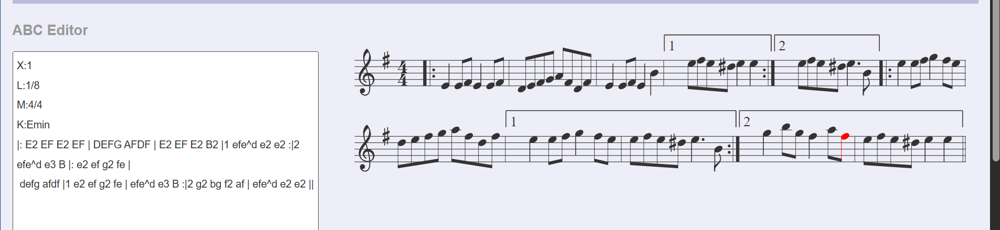
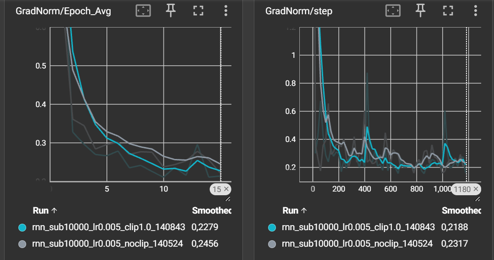
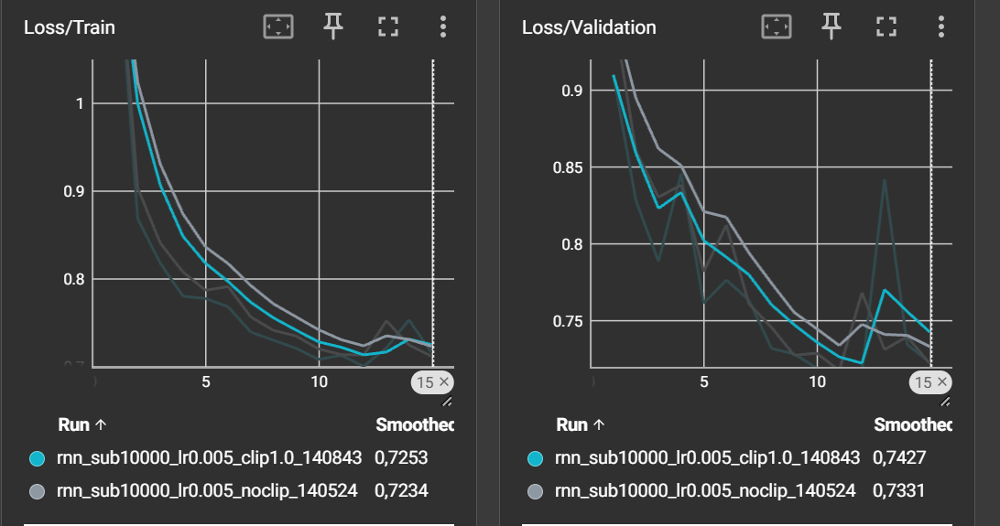
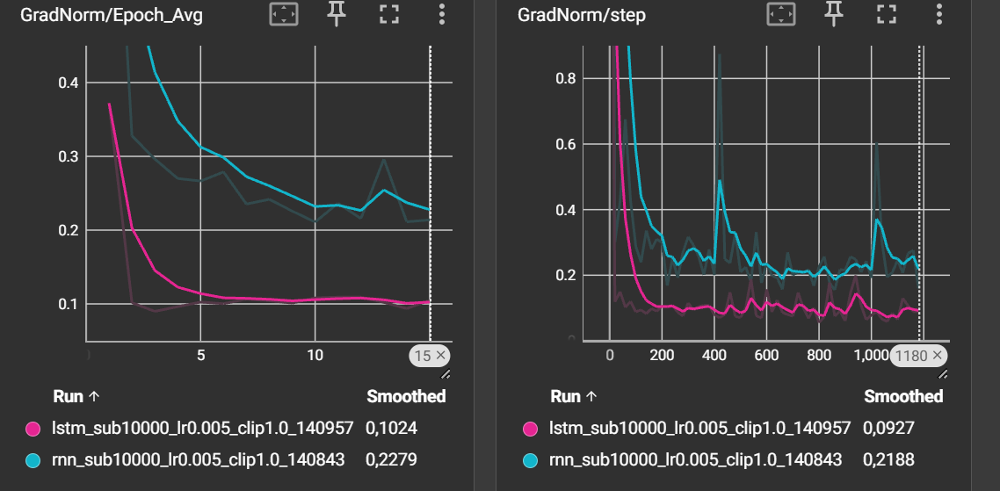
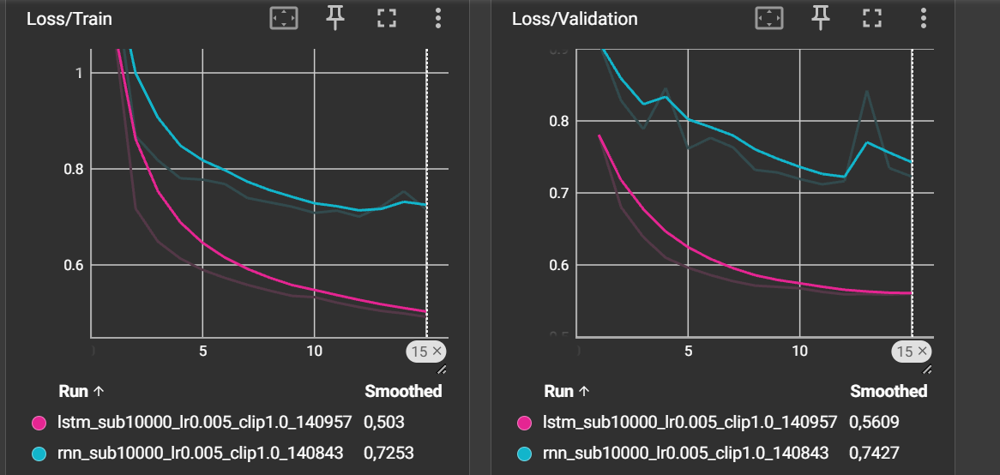
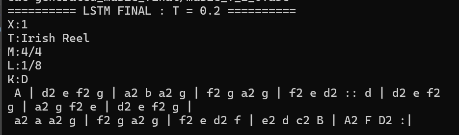
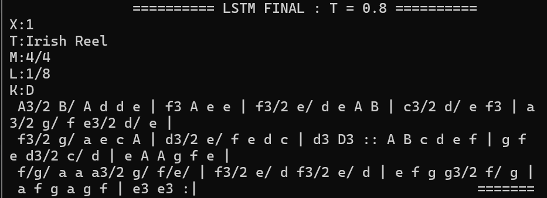
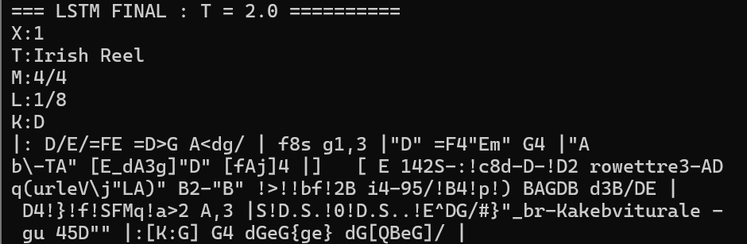

# TP4 — Réseaux récurrents et génération de séquences


# Exercice 1 — Exploration et prétraitement des données

## 1.1. Chargement des données

Nous avons chargé deux fichiers JSON contenant des partitions musicales au format ABC :

- `train.json` : 214 122 partitions pour l'entraînement.
- `validation.json` : 2 162 partitions pour la validation.

Chaque partition est accessible avec la clé `abc notation`.

## 1.2. Analyse d'une partition ABC

Voici un exemple de partition :

```text
X:1
L:1/8
M:4/4
K:Emin
|: E2 EF E2 EF | DEFG AFDF | E2 EF E2 B2 :|
```

Dans cette notation, `X` indique le numéro de la partition, `L` la durée des notes, `M` la mesure et `K` la tonalité. Les lettres représentent les notes et `|` sépare les mesures.

Le modèle apprend à prédire le caractère suivant pour générer de nouvelles partitions.



## 1.3. Construction du vocabulaire

Nous avons récupéré tous les caractères différents présents dans les partitions.

**Résultat : 95 caractères uniques.**

Nous avons ensuite créé deux dictionnaires : `char_to_index` pour convertir les caractères en nombres et `index_to_char` pour faire l'inverse.

Cela permet au modèle de travailler avec des données numériques, puis de reconstruire du texte musical.

## 1.4. Longueur des séquences

Les partitions contiennent en moyenne **290 caractères**, avec un maximum de **2 968 caractères**.

Nous avons fixé leur longueur à **500 caractères** :

- Les partitions plus courtes sont complétées avec des espaces (*padding*).
- Les partitions plus longues sont coupées à 500 caractères.

Cette méthode facilite l'entraînement par batchs, mais elle peut supprimer une partie des longues partitions. Les espaces ajoutés peuvent aussi fausser les résultats de précision.

---

# Exercice 2 — Dataset PyTorch et modèles RNN/LSTM

## 2.1. Création du Dataset

Nous avons implémenté une classe `MusicDataset` héritant de `torch.utils.data.Dataset`.

Son rôle est de transformer chaque partition musicale en une séquence d'indices numériques utilisable par PyTorch.

Pour chaque partition, nous construisons deux tenseurs :

```python
x = torch.tensor(
    seq[:-1],
    dtype=torch.long
)

y = torch.tensor(
    seq[1:],
    dtype=torch.long
)
```

Le tenseur `x` contient la séquence d'entrée.

Le tenseur `y` contient la même séquence décalée d'un caractère vers la gauche.

Par exemple, pour la séquence :

```text
ABCDE
```

Nous obtenons :

```text
x = ABCD
y = BCDE
```

Le modèle apprend ainsi à prédire le caractère suivant à chaque position.

### Vérification des dimensions

Avec :

```python
SEQ_LENGTH = 500
BATCH_SIZE = 128
```

Les tests ont donné :

| Tenseur | Dimensions | Type |
|---|---|---|
| `x` | `(128, 499)` | `torch.int64` |
| `y` | `(128, 499)` | `torch.int64` |

La longueur des séquences est égale à 499, car nous retirons un caractère pour construire les entrées et les cibles.

Le type `torch.int64`, également appelé `torch.long`, est nécessaire pour utiliser les indices dans une couche `nn.Embedding`.

## 2.2. Architecture générale des modèles

Nous avons construit une classe `MusicModel` permettant d'utiliser deux architectures :

- Un réseau récurrent simple : `nn.RNN`.
- Un réseau à mémoire longue : `nn.LSTM`.

Les deux modèles possèdent trois composants principaux.

### Couche Embedding

```python
nn.Embedding(vocab_size, embedding_dim)
```

Cette couche transforme chaque indice de caractère en un vecteur de dimension 256.

Elle permet au réseau d'apprendre une représentation numérique adaptée aux caractères musicaux.

### Couche récurrente

Pour le RNN :

```python
nn.RNN(
    input_size=256,
    hidden_size=512,
    batch_first=True
)
```

Pour le LSTM :

```python
nn.LSTM(
    input_size=256,
    hidden_size=512,
    batch_first=True
)
```

La couche récurrente traite les caractères successivement et maintient un état interne représentant les informations déjà rencontrées.

### Couche linéaire

```python
nn.Linear(512, vocab_size)
```

Cette couche transforme les sorties récurrentes en scores associés aux 95 caractères du vocabulaire.

### Hyperparamètres

| Hyperparamètre | Valeur |
|---|---:|
| Taille du vocabulaire | 95 |
| Dimension de l'embedding | 256 |
| Taille cachée | 512 |
| Nombre de couches récurrentes | 1 |
| `batch_first` | `True` |

Pour un batch de 128 séquences de longueur 499, la sortie du modèle possède les dimensions :

```text
(128, 499, 95)
```

Le modèle produit donc, à chaque position, un score pour chacun des 95 caractères possibles.

## 2.3. Nombre de paramètres

Nous avons utilisé une fonction `count_parameters()` pour compter les paramètres entraînables.

Les résultats obtenus sont :

| Couche | RNN | LSTM |
|---|---:|---:|
| Embedding | 24 320 | 24 320 |
| Couche récurrente | 394 240 | 1 576 960 |
| Couche linéaire | 48 735 | 48 735 |
| **Total** | **467 295** | **1 650 015** |


### Calcul pour le RNN

La couche Embedding contient :

`95 × 256 = 24 320`

La couche RNN contient :

`512 × 256 + 512 × 512 + 2 × 512 = 394 240`

La couche linéaire contient :

`512 × 95 + 95 = 48 735`

Le nombre total de paramètres est donc :

**24 320 + 394 240 + 48 735 = 467 295**

### Calcul pour le LSTM

La couche Embedding contient :

`95 × 256 = 24 320`

La couche LSTM contient :

`4 × (512 × 256 + 512 × 512 + 2 × 512) = 1 576 960`

La couche linéaire contient :

`512 × 95 + 95 = 48 735`

Le nombre total de paramètres est donc :

**24 320 + 1 576 960 + 48 735 = 1 650 015**
Le LSTM possède donc environ **3,53 fois plus de paramètres** que le RNN simple.

Cette différence s'explique par les quatre transformations internes du LSTM, qui contrôlent l'entrée, l'oubli, la sortie et la mise à jour de la mémoire.

## 2.4. Différences entre RNN et LSTM

Un RNN simple maintient un état caché `h`, mis à jour à chaque étape de la séquence.

Cependant, il peut rencontrer des difficultés pour conserver des informations sur de longues séquences, notamment à cause du problème de disparition des gradients.

Le LSTM utilise deux états :

- `h` : l'état caché.
- `c` : l'état de cellule, servant de mémoire interne.

Ses mécanismes de portes permettent de mieux contrôler les informations conservées et oubliées.

Le LSTM est donc conçu pour mieux gérer les dépendances à long terme.

Cette propriété peut être particulièrement utile pour les partitions musicales, dans lesquelles certaines structures se répètent après plusieurs mesures.

---

## Exercice 3 — Analyse expérimentale des RNN et LSTM

### 1. Manipulation des tenseurs

Nous utilisons `logits.reshape(-1, vocab_size)` et `y.reshape(-1)` pour adapter les tenseurs à `CrossEntropyLoss`.

Avec 128 séquences de 499 caractères, le `-1` représente **128 × 499 = 63 872 prédictions**.

Les dimensions deviennent `(63872, 95)` pour les prédictions et `(63872,)` pour les caractères attendus.

### 2. Gradient clipping

Le clipping doit être appliqué après `loss.backward()`, qui calcule les gradients, et avant `optimizer.step()`, qui met à jour les poids.

```python
optimizer.zero_grad()
loss.backward()
torch.nn.utils.clip_grad_norm_(model.parameters(), 1.0)
optimizer.step()
```

Il permet d'éviter les gradients trop grands qui peuvent rendre l'entraînement instable.

### 3. Analyse des courbes TensorBoard

**RNN sans clipping et RNN avec clipping**





Les deux RNN progressent de façon similaire. Le clipping réduit légèrement la norme moyenne des gradients.

La meilleure perte de validation est de **0,7091 avec clipping**, contre **0,7147 sans clipping**.

Le clipping sert à limiter les **gradients explosifs**, même si ce problème reste peu marqué dans notre expérience.

**RNN avec clipping et LSTM avec clipping**





Le LSTM converge plus rapidement et obtient de meilleurs résultats :

| Modèle | Meilleure Loss de validation | Accuracy de validation |
|---|---:|---:|
| RNN avec clipping | 0,7091 | 77,83 % |
| LSTM avec clipping | 0,5597 | ≈ 82 % |


La porte d'oubli \(f_t\) contrôle ce qui est conservé, et la porte d'entrée \(i_t\) contrôle les nouvelles informations. Cette mémoire facilite la circulation des gradients et permet de mieux apprendre les motifs musicaux sur de longues séquences.

### 4. Limite de l'Accuracy

Les partitions sont complétées avec des espaces jusqu'à 500 caractères. Le modèle peut donc obtenir une bonne précision en prédisant ces espaces plutôt que les notes.

Pour ignorer ces caractères dans la perte, on peut utiliser :

```python
loss_fn = nn.CrossEntropyLoss(
    ignore_index=char_to_index[" "]
)
```

Cette méthode ignore aussi les espaces normaux des partitions. Une meilleure solution serait d'utiliser un symbole spécial pour le padding et de l'exclure également du calcul de l'accuracy.
---

## Exercice 4 — Génération de séquences musicales

### 1. Influence de la température

Nous avons utilisé le LSTM de l'exercice 3 pour générer 300 caractères à partir de cette amorce :

```text
X:1
T:Irish Reel
M:4/4
L:1/8
K:D
```

Nous avons testé trois températures pour voir leur influence sur les partitions générées.

- **T = 0.2 :** la mélodie est assez régulière, mais les mêmes motifs reviennent souvent.
- **T = 0.8 :** les notes et les rythmes sont plus variés, tout en gardant une structure musicale assez cohérente.
- **T = 2.0 :** la génération devient trop aléatoire et contient beaucoup d'erreurs dans la notation ABC.

La température **0.8** semble donc offrir le meilleur équilibre entre variété et cohérence.

### 2. Optimisation de la génération

Pour accélérer la génération, nous conservons l'état caché du LSTM après chaque caractère. Cela évite de recalculer toute la séquence à chaque étape.

### 3. Entraînement du LSTM final

Nous avons entraîné un LSTM plus grand avec :

- **50 000 partitions** au lieu de 10 000.
- **1 024 unités cachées** au lieu de 512.
- **30 époques**, avec un gradient clipping de 1.0.

L'entraînement sur Arcadia a duré environ **30 minutes**.

| Résultat | LSTM initial | LSTM final |
|---|---:|---:|
| Meilleure perte de validation | 0,5597 | 0,4512 |
| Précision de validation observée | ≈ 82 % | ≈ 85,5 % |

Le nouveau modèle obtient de meilleurs résultats. Cependant, la perte de validation commence à augmenter après l'époque 13, ce qui montre un début de surapprentissage. Nous avons donc conservé le meilleur modèle sauvegardé.

### 4. Comparaison des partitions générées

Nous avons généré trois nouvelles partitions avec le LSTM final.

- **T = 0.2 :** les mélodies semblent moins répétitives qu'avec le premier modèle.

- **T = 0.8 :** les séquences sont plus longues et présentent davantage de variations.

- **T = 2.0 :** les partitions restent désordonnées et contiennent des erreurs.


### Bonus — Augmentation des données musicales

Pour augmenter les données, nous pourrions **transposer les mélodies** dans d'autres tonalités.

Par exemple, une mélodie en Ré majeur (`K:D`) pourrait être transposée en Mi majeur (`K:E`). Il faudrait modifier les notes, les altérations et la tonalité indiquée dans l'en-tête `K:`, tout en conservant le rythme.

Cela permettrait de créer plusieurs versions d'une même partition sans changer sa structure musicale.

Le modèle apprendrait ainsi des motifs plus variés au lieu de mémoriser les partitions d'entraînement. **Cela pourrait réduire le surapprentissage** et améliorer sa capacité à générer de nouvelles mélodies.

### Conclusion

Le LSTM final prédit mieux les caractères et produit des partitions qui semblent plus variées. La température **0.8** reste le meilleur choix parmi les trois valeurs testées.

Cependant, il faudrait écouter les partitions pour confirmer leur qualité musicale.
