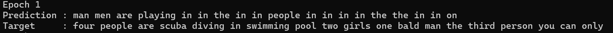
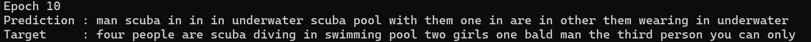
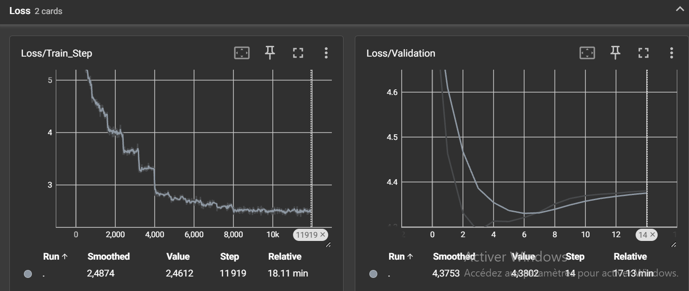
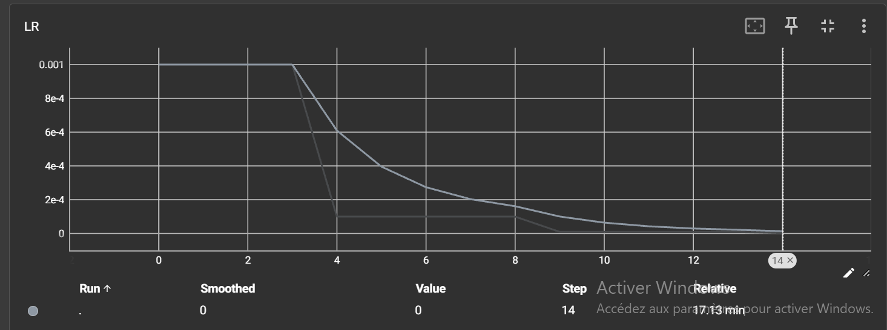

# TP5 — CI5 : Image Captioning avec RNN et Attention sur ResNet

## Exercice 1 — Chargement des données et embeddings

### Pourquoi redimensionner les images en (224, 224) ?

Les images de Flickr30k ont des tailles différentes. On les redimensionne en **224 × 224** pour qu'elles aient toutes la même taille et soient compatibles avec ResNet50. Cela facilite aussi l'entraînement et réduit les calculs.
Le dataset contient **31 783 images**, réparties en **25 426 pour l'entraînement** et **6 357 pour le test**. Les images sont normalisées avec les statistiques d'ImageNet.
Pour les légendes, on utilise **Word2Vec** avec des vecteurs de 300 dimensions et un vocabulaire de **20 226 mots**.
## Exercice 2 — Extraction de caractéristiques et Transfer Learning

### Pourquoi on gele les poids de ResNet50 ?

- **Raison matérielle :** le gel des poids (`requires_grad = False`) évite de calculer et de stocker les gradients du CNN, ce qui réduit l'utilisation de mémoire GPU et le coût de l'entraînement.
- **Raison algorithmique :** ResNet50 possède déjà des caractéristiques visuelles apprises sur ImageNet. Les conserver permet de bénéficier du transfert d'apprentissage et de limiter le risque de surapprentissage lié au réentraînement de tout le CNN sur Flickr30k.

### Dimension de sortie de `cnn_features`

Les deux dernières couches de ResNet50 sont retirées pour conserver les caractéristiques spatiales. Pour un tenseur d'entrée de forme **`(32, 3, 224, 224)`**, la sortie de `cnn_features` a la forme : **`(32, 2048, 7, 7)`**

Chaque image est donc représentée par 49 régions spatiales (7 × 7), avec 2 048 caractéristiques par région.

## Exercice 3 — Module d'attention et LSTM personnalisé

### Signification de `context_vector` et intérêt pour Seq2Seq

Le **`context_vector`** est une somme pondérée des caractéristiques des 49 régions de l'image, où les poids d'attention dépendent de l'état caché courant du LSTM.

Ce mécanisme réduit le goulot d'étranglement du Seq2Seq de base, qui consiste à résumer toute l'information de l'entrée dans un unique vecteur fixe : le LSTM peut ici sélectionner un contexte visuel différent à chaque pas de temps.

## Exercice 4 — Modèle global et entraînement

### Comparaison des prédictions aux époques 1 et 10

**Légende de référence (Target) :**

> four people are scuba diving in swimming pool two girls one bald man the third person you can only

**Époque 1 — Prediction :**

**Époque 10 — Prediction :**

À l'époque 1, la légende est peu cohérente avec la scène et présente de nombreuses répétitions, notamment du mot « in ». À l'époque 10, des mots liés à l'image et à la légende de référence apparaissent, comme « scuba », « underwater » et « pool ». La **pertinence du vocabulaire s'améliore**, mais la syntaxe reste incorrecte et les répétitions persistent. La légende produite n'est donc pas encore une phrase fluide.

### Impact du scheduler StepLR

**Perte d'entraînement (`Loss/Train_Step`) et perte de validation (`Loss/Validation`) :**

**Évolution du taux d'apprentissage (`LR`) :**

Avec `StepLR`, le learning rate est divisé par 10 toutes les 5 époques. Il passe de **0.001 à 0.0001**, puis à **0.00001**.

Cela permet au modèle d'apprendre plus doucement vers la fin et d'éviter des mises à jour trop importantes. C'est aussi utile avec Adam, même s'il adapte déjà les gradients.

D'après les résultats, la perte de validation atteint son minimum de **4.2896 à l'époque 4**, puis augmente légèrement jusqu'à **4.3802 à l'époque 15**. Cela montre un début de surapprentissage.

